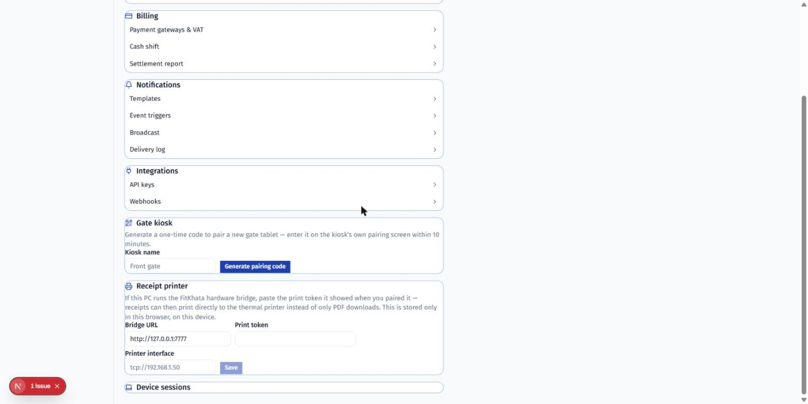
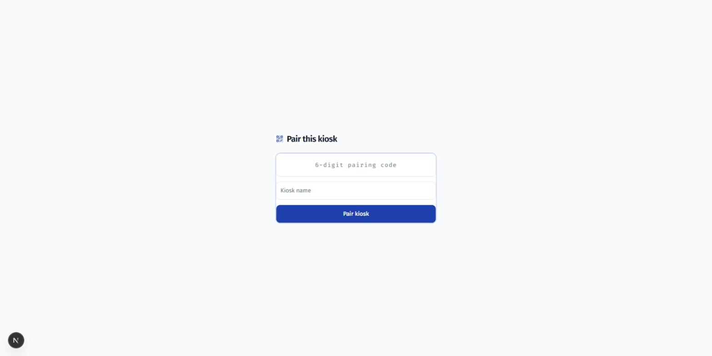

# Gate Tablet Setup

How to put a new check-in tablet at your gate, from unboxing to a working
scan.

## What you need

- An Android tablet (or any device with a camera and a web browser) to
  mount at the gate.
- Wi-Fi at the gate location.
- Someone with **manager** access or above, signed in on a phone or
  laptop, to generate the pairing code.
- *Optional, for biometric/turnstile/thermal-printer setups only:* a
  Windows PC or Raspberry Pi on the same network running the FitKhata
  hardware bridge (`apps/bridge`) — most gyms don't need this for a plain
  QR-scan gate.

## 1. Generate a pairing code

On any other device, sign in and go to **Settings → Gate kiosk**. Give the
kiosk a name (e.g. "Front gate") and tap **Generate pairing code**:

The code is 6 digits and expires in **10 minutes** — if it expires before
you finish step 2, just generate a new one.

## 2. Pair the tablet

On the tablet's browser, open your gym's gate URL (`<your-domain>/gate`).
A brand-new tablet shows the pairing screen automatically:

Enter the code from step 1 and the same kiosk name, then tap **Pair
kiosk**. Once paired, this tablet is permanently bound to your gym — the
code is single-use and can't pair a second device.

## 3. Mount and test

- Mount the tablet where a member can comfortably hold their phone's QR
  pass up to the camera — about chest height, camera facing outward.
- Set the tablet to **never sleep** / disable auto-lock (Android: Settings
  → Display → Screen timeout → Never, or use a dedicated kiosk-mode app
  if your tablet supports it) so it stays on the scan screen.
- Open the FitKhata member app on your own phone, pull up your QR pass,
  and scan it at the tablet. You should see a green result with your name
  and photo within half a second.
- Turn off the tablet's Wi-Fi briefly and scan again — it should still
  work (check-ins are validated and queued locally, then synced once
  back online), confirming offline mode is working before you rely on it.

## If something's wrong

- **Pairing code says invalid/expired:** codes expire in 10 minutes and
  work once — generate a fresh one.
- **Camera won't scan:** check the browser has camera permission for the
  site (most mobile browsers ask on first load); try reloading the page.
- **Scan result is always red for valid members:** check the tablet's
  clock is correct — QR passes are time-windowed and a wrong clock will
  reject everything.
- **Need to re-pair or replace this tablet:** ask an owner to revoke the
  old device and generate a new pairing code for the replacement.

For biometric devices, turnstiles, or thermal receipt printers, see the
separate hardware-bridge setup notes in `apps/bridge/README.md` — those
are optional add-ons on top of this basic QR-gate setup, not required to
get a gate working.
