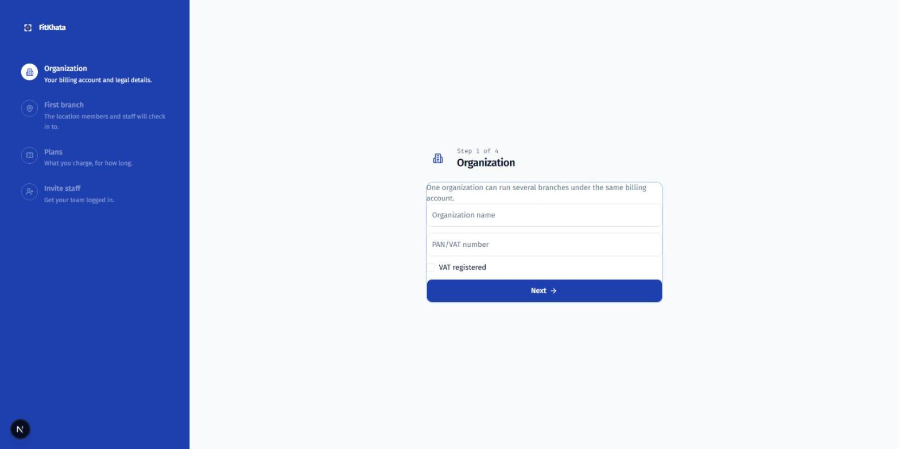

# Owner Guide

Everything you need to get your gym running on FitKhata, end to end.

## 1. Set up your account

Sign up and FitKhata walks you through a 4-step wizard:

1. **Organization** — your billing entity's name and PAN/VAT number. One
   organization can run several branches under the same billing account.
2. **First branch** — the actual location members check into (address,
   phone, timezone).
3. **Plans** — your first few membership plans (monthly/quarterly/annual
   pricing). You can add more any time under **Settings → Plans & add-ons**.
4. **Invite staff** — send sign-in invites to your managers and front-desk
   team by phone number; they'll each get their own login with a role
   (owner/manager/front-desk/trainer) that controls what they can see and do.

## 2. Turn on payments

**Settings → Payment gateways & VAT.** Each branch uses its *own* eSewa,
Khalti, or Fonepay merchant account — FitKhata never touches your money
directly. Add your credentials in **sandbox** mode first, run a test
transaction, confirm it completes, then switch the credential to **live**.
Do this for every branch separately.

If you're VAT-registered, also set whether your prices already include VAT
or whether VAT is added on top — this changes how every invoice is split.

## 3. Set up the gate and front desk

- **Settings → Gate kiosk**: generate a one-time pairing code for each
  tablet you're installing at a gate (see the separate *Gate Tablet
  Setup* guide for the hardware side).
- **Settings → Receipt printer**: if you're running the FitKhata hardware
  bridge on a front-desk PC for thermal receipt printing, paste its print
  token here.

## 4. Import your existing members

If you're moving from spreadsheets: **Settings → Membership → Import
members**, upload an Excel file, and FitKhata gives you a downloadable
error report for any rows it couldn't import (bad phone numbers, missing
required fields) so you can fix and re-upload just those.

## 5. Run the business day to day

- **Dashboard** — active members, today's/this month's revenue, renewals
  due soon, your red-list (at-risk) member count, and live occupancy.
- **Reports** — revenue trend, plan mix, attendance heatmap, cohort
  retention, dues ageing, the VAT sales register (owner-only), and a daily
  accounting-journal export formatted for Tally or Swastik.
- **Retention → Call queue** — every morning, your red-list members who
  haven't been called in 3 days, assigned round-robin to your front-desk
  staff. An item can't be cleared without logging an outcome.
- **Staff** — rosters, clock-in/out, leave, and monthly payroll (including
  trainer PT commission).

## 6. Your FitKhata subscription

**Settings** (as owner) shows your own plan, billing cycle, and member
limit. FitKhata bills you the same way you bill your members — same
eSewa/Khalti/Fonepay flow, or bank transfer confirmed by FitKhata support.
If a payment lapses, your account goes read-only (the gate keeps working,
no new sales) before anything more serious happens — paying brings it back
instantly.

## Need help?

The feedback button (top right, anywhere in the app) sends a message
straight to FitKhata support with the page you were on already attached.
